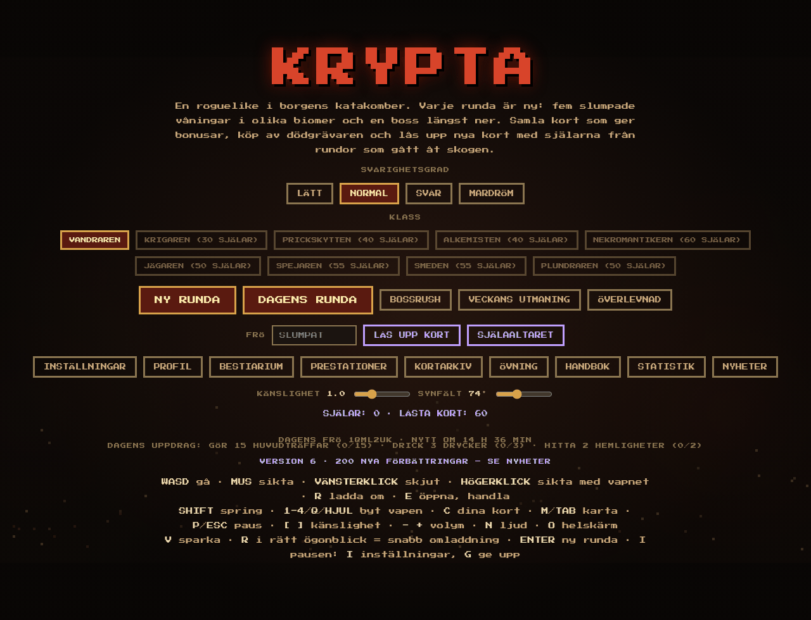
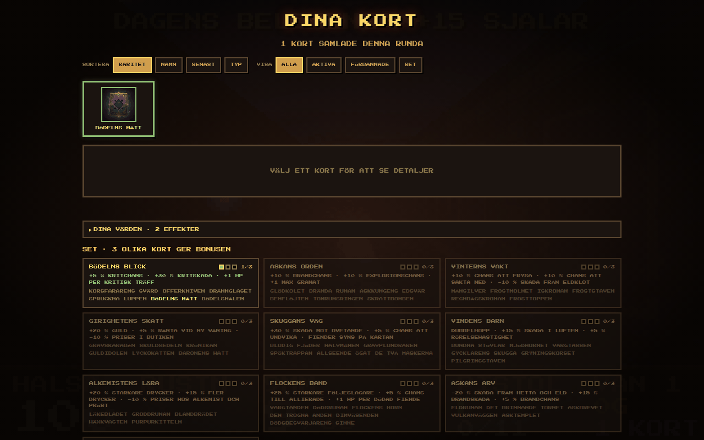
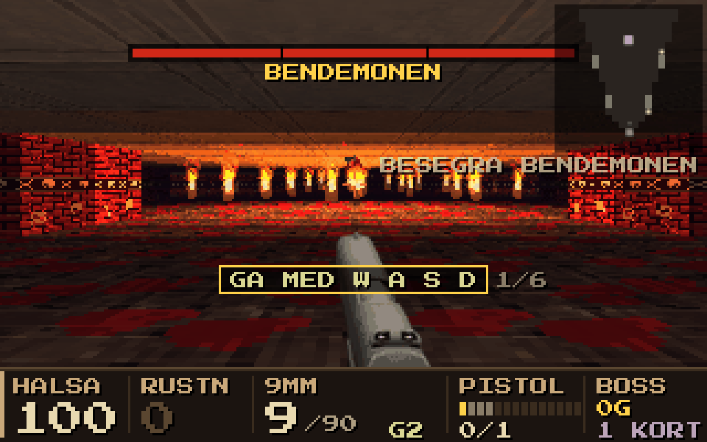

# KRYPTA

**Ett roguelike-FPS i Doom/Quake-stil – åtta biomer, 14 vapen, 232 kort och sju bossar. Ren JavaScript, inget byggsteg, inga beroenden.**



Krypta är en rutnätsraycaster som körs i webbläsaren. Varje runda är fem slumpade våningar och en boss längst ner. Korten du hittar gäller bara för rundan, medan själarna du samlar låser upp nya kort, klasser och uppgraderingar till nästa försök. Det går att spela med tangentbord och mus, handkontroll eller pekskärm.

|  |  |
|---|---|
| **Runda** | 5 våningar + boss per varv, oändligt djup |
| **Biomer** | 8, med egna banor, fiender, ljud och väder |
| **Vapen** | 14, plus vapenpakter och runor |
| **Kort** | 232 i fyra sällsyntheter, med set och synergier |
| **Bossar** | 7, var och en med egen arena och tre faser |
| **Svårighet** | Lätt, Normal, Svår och Mardröm, plus uppstigning 1–5 |
| **Klasser** | 9, som låses upp med själar |
| **Teknik** | Canvas, vanilla JS, WebAudio – inga npm-paket |

## Spela

Spelet behöver ingen installation och inget byggsteg. Hämta repot och servera mappen:

```bash
git clone https://github.com/felixarvid2/krypta.git
cd krypta
python3 -m http.server 8080
```

Öppna sedan <http://localhost:8080> och klicka **NY RUNDA**. Alla filer är statiska, så `npx serve .` eller vilken webbserver som helst fungerar också. Öppna helst spelet via en server och inte som en `file://`-adress, eftersom webbläsare kan blockera lokala filer.

Framsteg, inställningar och rekord sparas i webbläsarens `localStorage`. Inget skickas någonstans.

### Första rundan

1. Välj svårighetsgrad och klass på startskärmen. **Vandraren** är gratis; de andra klasserna låses upp med själar.
2. Välj ett av tre startkort. Kortet gäller hela rundan.
3. Utforska våningen. Hitta vapen, guld och kistor – och döda våningens elit (eller alla fiender om det inte finns någon elit) för att öppna portalen.
4. Efter varje våning får du välja ett nytt kort, handla när dödgrävaren dyker upp eller spara guldet.
5. Dör du är rundan över, men själarna finns kvar. Använd dem i **Själaaltaret** och **Lås upp kort** inför nästa försök.

## Kontroller

| Åtgärd | Tangent |
|---|---|
| Gå | `W` `A` `S` `D` |
| Sikta | Musen |
| Skjut / sikta med vapnet | Vänster / höger musknapp |
| Ladda om | `R` – tryck `R` igen i rätt ögonblick för snabb omladdning |
| Använd, öppna, handla | `E` |
| Sparka | `V` (eller `E` när det inte finns något att använda) |
| Hoppa / ducka / glid | `Space` / `Ctrl` (ducka medan du springer) |
| Springa / rusa | `Shift` / `Z`, eller dubbeltryck på en riktning |
| Granat | `F` – håll längre för att kasta längre |
| Dricka / byta dryck | `H` / `J` |
| Aktiv förmåga | `T` |
| Byt vapen | `1`–`0`, `§`, `Q` eller mushjulet. Håll `Q` för vapenhjulet. |
| Inspektera vapnet | `X` |
| Kort, karta, kartmarkör | `C`, `M`/`Tab` (tre lägen), `B` |
| Fotoläge / skärmbild | `K` (filter `1`–`4`) / `F9` |
| Paus | `P` eller `Esc`. I pausen: `I` inställningar, `G` ge upp, `M` karta. |
| Nästa våning / ny runda | `Enter` |
| Känslighet, synfält, volym | `[` `]`, `,` `.`, `-` `+` |
| Ljud av, helskärm | `N`, `O` |
| Svårighet mellan våningarna | `D` |

**Handkontroll:** gå, sikta, skjut och alla vanliga knappar stöds, med vibration och egna knappmappningar i inställningarna.

**Mobil:** vänster tumme styr en flytande joystick (dra långt för att springa) och höger tumme vrider. Ett snabbt tryck i bilden skjuter, och den stora knappen skjuter så länge du håller den – dra på den för att sikta samtidigt. Knapparna vid sidan av bilden siktar, laddar om, använder, byter vapen, dricker och öppnar karta, kort, förmåga och paus. Liggande läge ger störst bild. På Android vrids skärmen till liggande, och där webbläsaren inte tillåter helskärm (till exempel på iPhone) visas ett meddelande om det.

## Innehåll

### Åtta biomer

Varje varv består av fem våningar i slumpade biomer, och både storlek och fiender ökar med djupet. Utgången hamnar alltid längst bort från starten räknat i gångavstånd, och varje föremål som blockerar kontrolleras så att det aldrig stänger av en väg. Generatorn tar några millisekunder per våning.

| Biom | Miljö | Kännetecken |
|---|---|---|
| **Kryptan** | Inomhus | Rum och korridorer, sju teman, hemliga rum, skatt-, butiks- och elitrum |
| **Grottorna** | Inomhus | Cellautomater och slingrande gångar, droppstenar, lerfläckar |
| **Kyrkogården** | Utomhus, natt | Mur, kapell, gravkvarter, grusgångar, irrbloss och åska |
| **Skogen** | Utomhus | Tät skog och gläntor, stig med slinga, stuga med kista |
| **Borggården** | Delvis utomhus | Byggnadslängor, torn, pelare och en öppen gård |
| **Träsket** | Utomhus | Vatten, mossöar, spänger och hyddor på pålar |
| **Frostfästet** | Ute och inne | Snö, is, kyla, frusna sjöar och istappar |
| **Vulkanen** | Ute och inne | Obsidian, lava, aska, hetta och eldjetar |

Varje biom har egna väggar, golv, dimma, väder, partiklar, fotsteg, miljöljud och musik. Biomen styr också vilka fiender och rumstyper som dyker upp.

### Vapen

| Vapen | Ammunition | Roll |
|---|---|---|
| Pistol | 9 mm | Startvapen, exakt första skott |
| Hagelgevär | Patroner | Laddas patron för patron, mycket nära skada |
| Gevär | 5.56 | Automateld med lärbart rekylmönster |
| Kpist | 9 mm | Snabb, spridd, kort räckvidd |
| Dubbelbössa | Patroner | Två pipor, tio hagel per skott |
| Armborst | Bultar | Tyst, går igenom alla fiender |
| Signalpistol | Bloss | Sprängs och tänder eld |
| Prickskyttegevär | 5.56 | Hög skada, genomslag, stark zoom |
| Yxa | Närstrid | Svep mot flera fiender, laddat slag, kastas med högerklick |
| Eldkastare | Bränsle | Kontinuerlig låga som tänder eld och lyser upp |
| Granatkastare | Granater | Studsande granater, exploderar vid träff när du siktar |
| Spikgevär | Spikar | Snabba projektiler som kan spetsa fast fiender |
| Blixtstav | Mana | Kedjeblixt, laddas av sig själv, blixtklot med högerklick |
| Långbåge | Pilar | Håll för att spänna, fullt spänd gör dubbel skada |

Vapenpakter låser dig till ett vapen resten av rundan, men öppnar i gengäld vapnets unika uppgraderingar. Runor kan fästas i vapnet och ger effekter som eld, frost, gift, blixt, blod, eko och extra träffar.

### Kort

Det finns 232 kort i fyra sällsyntheter: vanlig, ovanlig, sällsynt och legendarisk. Korten ger permanenta bonusar under rundan – skada, eldhastighet, krit, genomslag, explosioner, brand, livsstöld, sköld, extraliv, magnet, rabatt och mycket mer. Tretton är förbannade: en stark fördel med en nackdel.

- **Synergier** mellan exempelvis eld och explosioner, eller krit och kritskada.
- **Set** där tre kort ur samma set ger en extra bonus.
- **Förädling** som gör ett kort starkare utan att du behöver ett till.
- **Aktiva förmågor** från fem kort: blink, tidsbubbla, sköldbubbla, vålnadskall och jordskalv (`T`).
- **Pakter**, butikens mysteriekort, förbannelser och möjligheten att förvisa kort ur poolen.

Kort kommer från startvalet, från kortvalet efter varje våning, från kistor, från eliter och bossar, och från dödgrävaren.

### Fiender och bossar

Fienderna har egna beteenden: slem som delar sig, shamaner som helar, magiker som väcker döda, gravrövare som hugger hårdare i ryggen, sköldbärare som blockerar framifrån och eldelementaler som delar sig i flammor. Eliter är större och har egenskaper som snabb, seg, blodtörstig, explosiv, brutal, teleporterande, läkande, speglande eller smygande. Från varv 2 kan de ha två egenskaper.

| Boss | Arena | Tema |
|---|---|---|
| **Bendemonen** | Tronsalen | Eldfläktar, vingslag och skelett |
| **Helvetesbesten** | Grottan | Eldpelare, magmabollar och lavavågor |
| **Mardrömmen** | Kyrkogården | Blå eld, stormningar och skuggkloner |
| **Ogern** | Skogsgläntan | Stenringar, rullande stockar och orkkrigare |
| **Vålnaden** | Träsket | Sökande klot, försvinnanden och skrik |
| **Isdraken** | Frostfästet | Isskärvor, istaggar och snöstorm |
| **Eldkungen** | Vulkanen | Lavapölar, utbrott och eldelementaler |

Alla bossar har tre faser, livmätare med fasgränser, egna anfall och en egen arena. Varje vanlig våning har dessutom ett väktarrum där en mindre version av en boss vaktar en skatt.

### Progressionssystem

- **Själar** tjänas på varje runda, mer på högre svårighet och i djupare varv.
- **Själaaltaret** ger bestående uppgraderingar: mer hälsa, startguld, startammo, rustning, extra kortval, extra runplats och fler lägereldar.
- **Klasser** och **kort** låses upp med själar. Nio klasser med olika startvapen och bonusar.
- **Uppstigning** (Mardröm 1–5) och utmaningarna *Ett slag*, *Snabb runda*, *Bara pistol* och *Inga kort* ger tuffare rundor och mer själar.
- **Profil, bestiarium, kortarkiv och statistik** visar rundor, rekord, dödade fiender, bossar, kort du sett och 90 prestationer.
- **Dagens runda**, **Veckans utmaning**, **Bossrush**, **Överlevnad** och **Övning** finns på startskärmen.

En runda är permadöd: dör du raderas sparfiten, och *Fortsätt* finns bara för en pågående runda (den laddar början av den senaste våningen).

### Känsla och tillgänglighet

- Lärbara rekylmönster, avståndsfall i skada och ett första skott som går exakt dit hårkorset pekar.
- Träffstopp, trauma²-baserad skärmskakning, blodstänk, kulhål, gnistor, spårljus och mynningsrök.
- Fiender som väntar en kort reaktionstid innan de anfaller, flankerar, flyr och lär sig var de senast såg dig.
- Positionsljud i stereo som dämpas bakom väggar, fotsteg i takt med farten och musik som växer i strid.
- Siktstöd på pekskärm och handkontroll, gyro-sikte och valfri automatisk skjutning på mobil.
- Ommappbara tangenter och handkontrollsknappar, tre färgblindlägen, minskade effekter och blixtar, textstorlek, undertexter, hjälpläge och 30 FPS-läge för svaga enheter.
- Skakningar, skadesiffror, fienders livmätare, FPS-räknare, karta och mycket annat kan stängas av i inställningarna.

## Skärmbilder

| Kortval | Bossstrid |
|---|---|
|  |  |

## Så är det byggt

```
index.html          startskärm, HUD-markup och globala stilar
css/cards.css       kortgränssnittet, kortleken och menyer
js/rng.js           fröbaserad slump – samma frö ger samma runda
js/gen.js           bangeneratorn: biomer, rum, fiender, fällor och bossarenor
js/cards.js         kortdefinitioner, sällsynthet, set och drops
js/cardui.js        kortval, kortleken, arkiv och menyerna
js/weapons.js       vapenramar och skjutanimationer (genererad)
js/music.js         procedurmusik, ljudbussar, eko och dämpning
js/game.js          spelmotorn: raycasting, strid, fiender, HUD och sparläge
tools/              tester, förhandsvisning och skript för grafik, ljud och kort
assets/             färdiga sprites, texturer, ljud och musik
```

Spelet ritas i 320×200 pixlar och skalas upp med pixlig filtrering. Motorn är en klassisk DDA-raycaster med texturerade väggar, golv och tak, sprite-baserade fiender och föremål, dynamiskt ljus och dimma. All spellogik ligger i vanilla JavaScript – det finns inget ramverk, ingen bundler och inga npm-beroenden i den färdiga sidan.

Banor, belöningar och fiender styrs av fröet, så samma frö ger alltid samma runda. Fröet visas i pausen och efter rundan och kan skrivas in på startskärmen.

## Utveckling och tester

Testerna körs direkt med Node, utan installation:

```bash
node tools/gen-test.js      # alla biomer, slumpade biomer och alla bossarenor
node tools/cards-test.js    # korten, sällsynthet, pakter och synergier
```

Båda ska sluta med `ALLA TESTER OK` respektive `OK: alla kontroller godkända`.

Skriv ut en våning som text i terminalen:

```bash
node tools/gen-preview.js random KRYPTA 3   # slumpad biom, frö och djup
node tools/gen-preview.js graveyard         # en viss biom
node tools/gen-preview.js boss:demon        # en bossarena
```

För att testa en viss biom, boss eller våning i webbläsaren finns URL-parametrar:

```
?biome=volcano   ?boss=flame   ?floor=6   ?seed=KRYPTA   ?diff=3
```

`tools/cards-demo.html` visar kortgränssnittet fristående.

### Grafik, ljud och kort

Skripten i `tools/` bygger om spelets resurser: `biome-textures/`, `boss-sprites/`, `enemy-sprites/`, `props*/`, `portal/`, `card-art/`, `weapon-cards/`, `weapon-frames/` och `sounds/`.

De läser källpaketen (`assets/2d-pixel`, `assets/3d-models`, `assets/audio` med flera) från det gamla repot [`felixarvid2/test`](https://github.com/felixarvid2/test), där spelet låg i mappen `retrofps/`. De förutsätter fortfarande den mappstrukturen: kör dem från en mapp som innehåller både källpaketens `assets/` och det här repot som `retrofps/`. Det behövs bara om du vill ändra bilder, ljud eller kortbilder – spelet i sig kräver inget av detta.

## Felsökning

- **Spelet laddar inte:** öppna det via en webbserver, inte som `file://`.
- **Inget ljud:** webbläsare kräver att du först klickar på sidan. Kontrollera också att ljudet inte är avstängt med `N`.
- **Framstegen försvinner:** spelet sparar i `localStorage`. Privat läge, blockerade cookies eller ett annat konto i webbläsaren kan rensa dem.
- **Låg FPS på mobil:** stäng av effekter, använd 30 FPS-läget eller minska knappstorleken i inställningarna.
- **Helskärm fungerar inte på iPhone:** Safari tillåter inte alltid helskärm eller låsning av orientering. Spelet visar då ett meddelande.

## Dokumentation och resurser

- [Versionshistorik](docs/VERSIONER.md) – den fullständiga listan över vad varje version lagt till.
- [Resurser och källor](docs/ASSETS.md) – var grafik, ljud, musik och typsnitt kommer ifrån.
- [Vapenbildrutor](tools/weapon-frames/README.md) – hur förstapersonsvapnen renderas.

## Licenser

Tredjepartsgrafik, ljud och typsnitt kommer från paket med öppna licenser – främst CC0, samt OFL för typsnittet Press Start 2P. Se [resurslistan](docs/ASSETS.md) för källa och licens per resurs.
